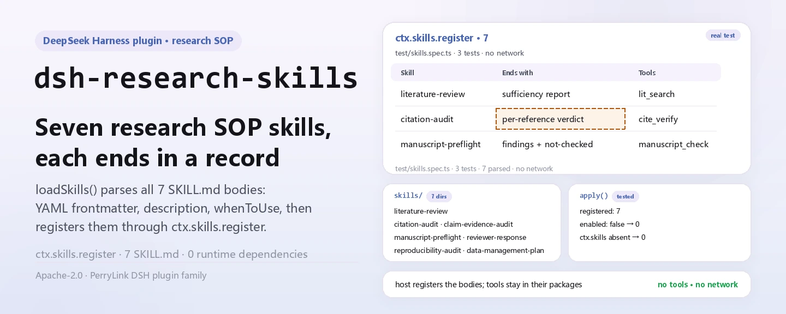
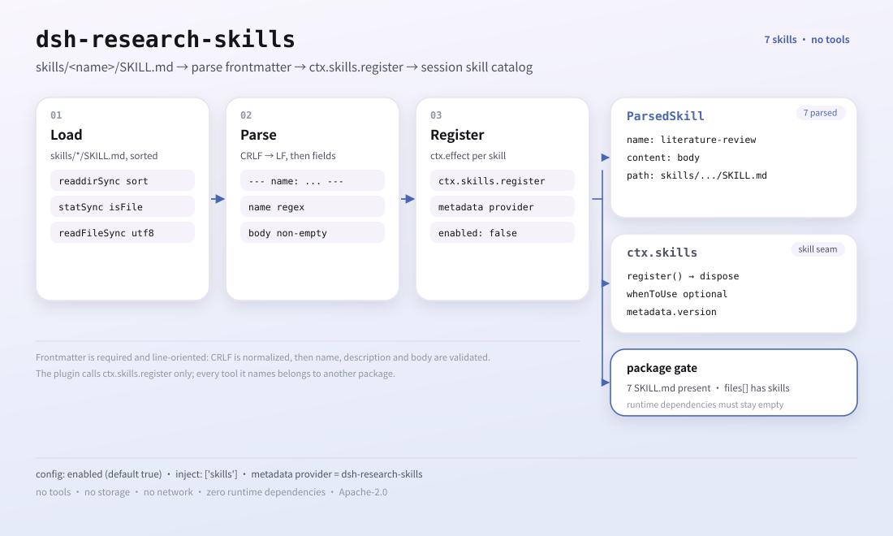

<div align="center">

<picture>
  <source media="(prefers-color-scheme: dark)" srcset="docs/assets/dsh-research-skills-hero-en-dark.webp">
  
</picture>

# dsh-research-skills

**Siete skills SOP de investigación para DeepSeek Harness — cada uno termina en un registro o en un veredicto explícito, nunca solo en prosa.**

*Revisión de literatura · auditoría de citas · auditoría de afirmaciones/evidencia · preflight de manuscrito · respuesta a revisores · auditoría de reproducibilidad · plan de gestión de datos. El plugin registra los cuerpos de los skills; las herramientas siguen en sus propios paquetes.*

[English](README.md) · [简体中文](README-zh.md) · [Español](README-es.md) · [Português](README-pt.md) · [हिन्दी](README-hi.md)

[](LICENSE)

<sub>Compatibilidad de host: DeepSeek Harness `dsh-v0.2.2-rc.4` (verificado 2026-11-18).</sub>

</div>

---

## Skills

| Skill | Cuándo usarlo | Termina en |
|---|---|---|
| `literature-review` | se pide una revisión / related work / mapa de evidencia | informe de suficiencia + informe sellado |
| `citation-audit` | una lista de referencias debe ser real, correcta y no retractada | veredicto por referencia + exportación |
| `claim-evidence-audit` | hay afirmaciones que comprobar contra su evidencia | rastro claim → evidencia → veredicto |
| `manuscript-preflight` | el usuario está a punto de enviar | hallazgos por comprobación + lista de "no comprobado" |
| `reviewer-response` | los comentarios de los revisores piden una carta punto por punto | tabla de cobertura + carta de respuesta |
| `reproducibility-audit` | "¿puede alguien reproducir esto?" | manifiesto de artefactos + veredicto de deriva |
| `data-management-plan` | toca entregar un DMP / ética / declaración de disponibilidad de datos | secciones completadas + preguntas abiertas |

Cada `SKILL.md` indica las herramientas concretas (`lit_search`, `cite_verify`, `claim_check`, `research_trail`, `repro_audit`, `dmp`, …), el orden en que hay que llamarlas y qué no se debe afirmar nunca.

<picture>
  <source media="(prefers-color-scheme: dark)" srcset="docs/assets/dsh-research-skills-flow-v5-dark.svg">
  /SKILL.md ordenado se lee, su frontmatter YAML y su cuerpo se analizan y validan, y luego cada uno se registra mediante ctx.skills.register para que el catálogo de skills de la sesión contenga los siete; los campos analizados y la costura de registro se muestran a la derecha, y la compuerta del paquete mantiene honestos la lista de archivos publicados y el conjunto vacío de dependencias en tiempo de ejecución">
</picture>

*Estructura: cargar → analizar → registrar; los siete cuerpos `SKILL.md` son todo el plugin, y las herramientas que nombran viven en otros paquetes. Las etiquetas de token dentro del diagrama son los nombres reales de la API y de los campos, así que la misma imagen sirve para los cinco idiomas.*

## Instalación

```sh
dsh plugin --profile <name> add dsh-research-skills
dsh --profile <name> --dump-config | grep dsh-research-skills
```

Los skills aparecen en el catálogo de skills de la sesión; las herramientas a las que hacen referencia son paquetes aparte (instala el research suite para el conjunto completo).

## Lo que no hace

- **Sin herramientas, sin almacenamiento, sin red.** Solo llama a `ctx.skills.register`.
- **Sin instrucciones ocultas.** Cada cuerpo es un `SKILL.md` plano dentro de este paquete.
- **Sin reglas específicas de revista.** Los skills de checklist dicen qué ítems iniciales de la guía cubren y cuáles no.

## Compatibilidad

| | |
|---|---|
| DeepSeek Harness | línea peer `dsh-v0.2.3-alpha.1` (verificado 2026-11-22); `>=0.2.1-0 <0.3.0 \|\| >=0.2.2-0 <0.3.0` |
| Node | `^22.19.0 \|\| >=24.9.0` |
| Dependencias en tiempo de ejecución | **cero** |

## Desarrollo


*Animado: la salida real de `pnpm test`, `pnpm run verify:package` y `pnpm run check:lockfile` el 2026-11-21 (3 tests en 1 archivo; el plugin no tiene CLI, así que su propia suite y las compuertas del paquete son la ejecución). La marca de aprobado se omite porque la fuente del terminal no tiene ese glifo; los nombres de archivo, los conteos y las líneas de las compuertas son literales.*

```sh
pnpm install
pnpm run check:lockfile
pnpm typecheck
pnpm test
pnpm build
pnpm verify:package
```

El lockfile se commitea exactamente como lo escribe `pnpm install --lockfile-only` (dos documentos: el documento del gestor de paquetes de pnpm y luego el documento del proyecto), así que un install local no lo reescribe. `pnpm run check:lockfile` falla cuando el lockfile se desvía de `package.json` o pierde esa forma.

## Licencia

Apache-2.0. Ver [LICENSE](LICENSE).
