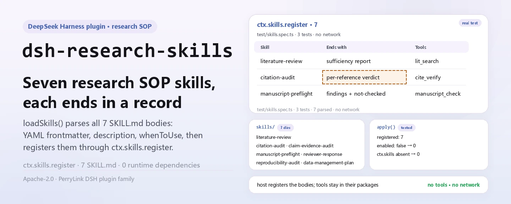
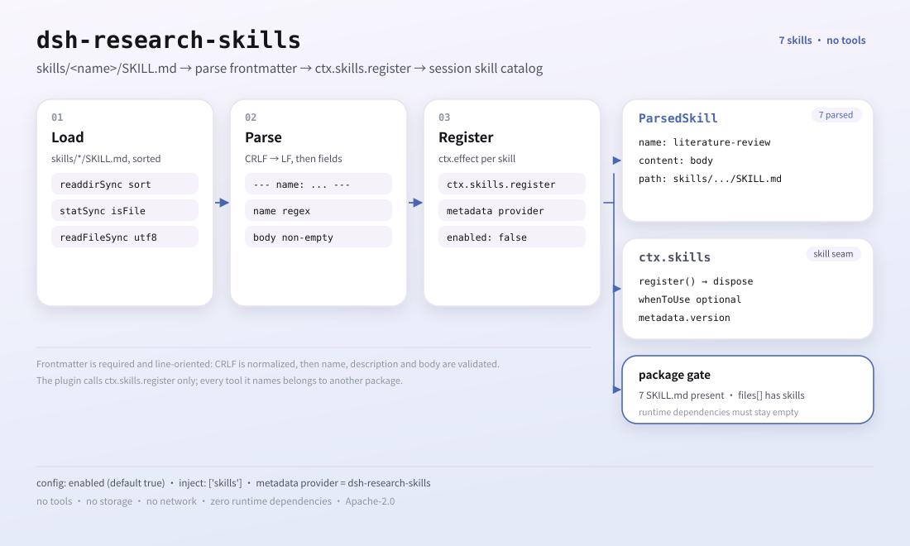

<div align="center">

<picture>
  <source media="(prefers-color-scheme: dark)" srcset="docs/assets/dsh-research-skills-hero-en-dark.webp">
  
</picture>

# dsh-research-skills

**DeepSeek Harness के लिए सात रिसर्च SOP स्किल — हर एक किसी रिकॉर्ड या स्पष्ट निर्णय पर समाप्त होता है, केवल गद्य पर कभी नहीं।**

*साहित्य समीक्षा · साइटेशन ऑडिट · दावा/प्रमाण ऑडिट · पांडुलिपि प्रीफ़्लाइट · समीक्षक-उत्तर · प्रतिलिपि-क्षमता ऑडिट · डेटा-प्रबंधन योजना। प्लगइन स्किल के बॉडी पंजीकृत करता है; टूल अपने-अपने पैकेज में रहते हैं।*

[English](README.md) · [简体中文](README-zh.md) · [Español](README-es.md) · [Português](README-pt.md) · [हिन्दी](README-hi.md)

[](LICENSE)

<sub>होस्ट संगतता: DeepSeek Harness `dsh-v0.2.2-rc.4` (2026-11-18 को सत्यापित)।</sub>

</div>

---

## स्किल

| स्किल | कब इस्तेमाल करें | किस पर समाप्त होता है |
|---|---|---|
| `literature-review` | समीक्षा / related work / प्रमाण-मानचित्र माँगा जाए | पर्याप्तता रिपोर्ट + सीलबंद रिपोर्ट |
| `citation-audit` | संदर्भ-सूची वास्तविक, सही और अपरिवर्तित (retraction-मुक्त) होनी चाहिए | प्रति-संदर्भ निर्णय + निर्यात |
| `claim-evidence-audit` | दावों को उनके प्रमाण के सामने जाँचना हो | दावा → प्रमाण → निर्णय का ट्रेल |
| `manuscript-preflight` | उपयोगकर्ता सबमिशन की तैयारी में हो | जाँच-वार निष्कर्ष + "जाँच नहीं हुआ" सूची |
| `reviewer-response` | समीक्षकों की टिप्पणियों पर बिंदु-दर-बिंदु पत्र चाहिए | कवरेज तालिका + उत्तर पत्र |
| `reproducibility-audit` | "क्या कोई इसे दोबारा पैदा कर सकता है?" | आर्टिफ़ैक्ट मैनिफ़ेस्ट + ड्रिफ्ट निर्णय |
| `data-management-plan` | DMP / नैतिकता / डेटा-उपलब्धता वक्तव्य देना हो | पूर्ण अनुभाग + खुले प्रश्न |

हर `SKILL.md` ठोस टूल (`lit_search`, `cite_verify`, `claim_check`, `research_trail`, `repro_audit`, `dmp`, …), उन्हें किस क्रम में कॉल करना है, और क्या कभी दावा नहीं करना है — यह सब लिखता है।

<picture>
  <source media="(prefers-color-scheme: dark)" srcset="docs/assets/dsh-research-skills-flow-v5-dark.svg">
  /SKILL.md पढ़े जाते हैं, उनका YAML frontmatter और बॉडी पार्स और सत्यापित की जाती है, फिर हर एक ctx.skills.register से पंजीकृत होता है जिससे सत्र के स्किल कैटलॉग में सातों आ जाएँ; पार्स किए गए फ़ील्ड और पंजीकरण की सीमा दाईं ओर हैं, और पैकेज गेट प्रकाशित फ़ाइल-सूची तथा खाली रनटाइम-निर्भरता समुच्चय को ईमानदार रखता है">
</picture>

*संरचना: लोड → पार्स → पंजीकरण; सातों `SKILL.md` बॉडी ही पूरा प्लगइन हैं, और वे जिन टूल के नाम लेते हैं वे दूसरे पैकेज में रहते हैं। डायग्राम के अंदर के टोकन लेबल असली API और फ़ील्ड नाम हैं, इसलिए एक ही चित्र पाँचों भाषाओं के लिए काम आता है।*

## इंस्टॉल

```sh
dsh plugin --profile <name> add dsh-research-skills
dsh --profile <name> --dump-config | grep dsh-research-skills
```

स्किल सत्र के स्किल कैटलॉग में दिखते हैं; वे जिन टूल का संदर्भ देते हैं वे अलग पैकेज हैं (पूरा सेट चाहिए तो research suite इंस्टॉल करें)।

## यह क्या नहीं करता

- **कोई टूल नहीं, कोई स्टोरेज नहीं, कोई नेटवर्क नहीं।** यह केवल `ctx.skills.register` कॉल करता है।
- **कोई छिपे निर्देश नहीं।** हर बॉडी इस पैकेज में एक सादा `SKILL.md` है।
- **किसी पत्रिका के विशेष नियम नहीं।** चेकलिस्ट स्किल बताते हैं कि वे किन शुरुआती गाइडलाइन मदों को कवर करते हैं और किन्हें नहीं।

## संगतता

| | |
|---|---|
| DeepSeek Harness | peer लाइन `dsh-v0.2.2-rc.4` (2026-11-18 को सत्यापित); `>=0.2.1-0 <0.3.0 \|\| >=0.2.2-0 <0.3.0` |
| Node | `^22.19.0 \|\| >=24.9.0` |
| रनटाइम निर्भरताएँ | **शून्य** |

## विकास


*एनिमेटेड: 2026-11-21 को `pnpm test`, `pnpm run verify:package` और `pnpm run check:lockfile` का असली आउटपुट (1 फ़ाइल में 3 टेस्ट; प्लगइन का कोई CLI नहीं है, इसलिए उसका अपना सूट और पैकेज गेट ही रन हैं)। पास-मार्कर छोड़ा गया है क्योंकि टर्मिनल फ़ॉन्ट में वह ग्लिफ़ नहीं है; फ़ाइल नाम, गिनतियाँ और गेट की पंक्तियाँ शब्दशः हैं।*

```sh
pnpm install
pnpm run check:lockfile
pnpm typecheck
pnpm test
pnpm build
pnpm verify:package
```

लॉकफ़ाइल ठीक वैसे ही कमिट की जाती है जैसे `pnpm install --lockfile-only` उसे लिखता है (दो दस्तावेज़: पहले pnpm का स्वयं का पैकेज-मैनेजर दस्तावेज़, फिर प्रोजेक्ट दस्तावेज़), इसलिए लोकल इंस्टॉल उसे दोबारा नहीं लिखता। `pnpm run check:lockfile` तब विफल होता है जब लॉकफ़ाइल `package.json` से हट जाए या वह रूप खो दे।

## लाइसेंस

Apache-2.0. देखें [LICENSE](LICENSE).
