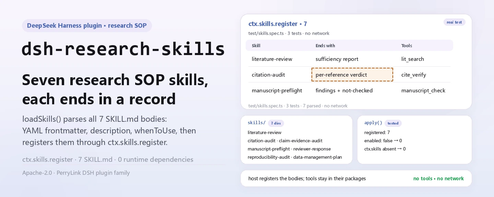
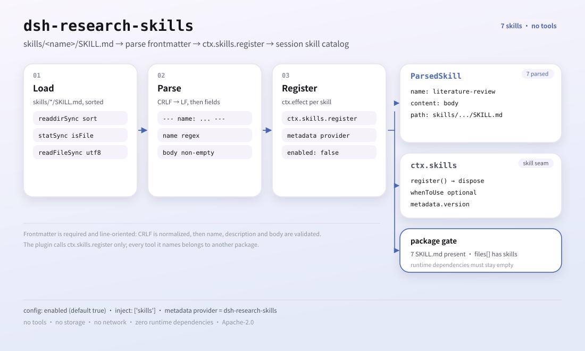

<div align="center">

<picture>
  <source media="(prefers-color-scheme: dark)" srcset="docs/assets/dsh-research-skills-hero-en-dark.webp">
  
</picture>

# dsh-research-skills

**Sete skills SOP de pesquisa para o DeepSeek Harness — cada um termina em um registro ou em um veredicto explícito, nunca apenas em prosa.**

*Revisão de literatura · auditoria de citações · auditoria de afirmações/evidências · preflight de manuscrito · resposta a revisores · auditoria de reprodutibilidade · plano de gestão de dados. O plugin registra os corpos dos skills; as ferramentas continuam em seus próprios pacotes.*

[English](README.md) · [简体中文](README-zh.md) · [Español](README-es.md) · [Português](README-pt.md) · [हिन्दी](README-hi.md)

[](LICENSE)

<sub>Compatibilidade de host: DeepSeek Harness `dsh-v0.2.2-rc.4` (verificado em 2026-11-18).</sub>

</div>

---

## Skills

| Skill | Quando usar | Termina em |
|---|---|---|
| `literature-review` | pede-se uma revisão / related work / mapa de evidências | relatório de suficiência + relatório selado |
| `citation-audit` | uma lista de referências precisa ser real, correta e não retratada | veredicto por referência + exportação |
| `claim-evidence-audit` | afirmações precisam ser checadas contra suas evidências | trilha claim → evidência → veredicto |
| `manuscript-preflight` | o usuário está prestes a submeter | achados por checagem + lista de "não checado" |
| `reviewer-response` | comentários de revisores exigem uma carta ponto a ponto | tabela de cobertura + carta de resposta |
| `reproducibility-audit` | "alguém consegue reproduzir isto?" | manifesto de artefatos + veredicto de drift |
| `data-management-plan` | um DMP / ética / declaração de disponibilidade de dados é exigido | seções preenchidas + questões em aberto |

Cada `SKILL.md` nomeia as ferramentas concretas (`lit_search`, `cite_verify`, `claim_check`, `research_trail`, `repro_audit`, `dmp`, …), a ordem de chamada e o que nunca pode ser afirmado.

<picture>
  <source media="(prefers-color-scheme: dark)" srcset="docs/assets/dsh-research-skills-flow-v5-dark.svg">
  /SKILL.md ordenado é lido, seu frontmatter YAML e seu corpo são analisados e validados, e então cada um é registrado via ctx.skills.register para que o catálogo de skills da sessão contenha os sete; os campos analisados e a costura de registro aparecem à direita, e o gate do pacote mantém honestos a lista de arquivos publicados e o conjunto vazio de dependências de runtime">
</picture>

*Estrutura: carregar → analisar → registrar; os sete corpos `SKILL.md` são o plugin inteiro, e as ferramentas que eles nomeiam vivem em outros pacotes. Os rótulos de token dentro do diagrama são os nomes reais da API e dos campos, então a mesma imagem serve aos cinco idiomas.*

## Instalação

```sh
dsh plugin --profile <name> add dsh-research-skills
dsh --profile <name> --dump-config | grep dsh-research-skills
```

Os skills aparecem no catálogo de skills da sessão; as ferramentas que eles referenciam são pacotes separados (instale o research suite para o conjunto completo).

## O que ele não faz

- **Sem ferramentas, sem armazenamento, sem rede.** Ele só chama `ctx.skills.register`.
- **Sem instruções ocultas.** Cada corpo é um `SKILL.md` simples dentro deste pacote.
- **Sem regras específicas de periódico.** Os skills de checklist dizem quais itens iniciais da diretriz cobrem e quais não cobrem.

## Compatibilidade

| | |
|---|---|
| DeepSeek Harness | linha peer `dsh-v0.2.3-alpha.1` (verificado em 2026-11-22); `>=0.2.1-0 <0.3.0 \|\| >=0.2.2-0 <0.3.0` |
| Node | `^22.19.0 \|\| >=24.9.0` |
| Dependências de runtime | **zero** |

## Desenvolvimento


*Animado: a saída real de `pnpm test`, `pnpm run verify:package` e `pnpm run check:lockfile` em 2026-11-21 (3 testes em 1 arquivo; o plugin não tem CLI, então sua própria suíte e os gates do pacote são a execução). A marca de aprovação é omitida porque a fonte do terminal não tem esse glifo; os nomes de arquivo, as contagens e as linhas dos gates são literais.*

```sh
pnpm install
pnpm run check:lockfile
pnpm typecheck
pnpm test
pnpm build
pnpm verify:package
```

O lockfile é commitado exatamente como `pnpm install --lockfile-only` o escreve (dois documentos: o documento do gerenciador de pacotes do pnpm e depois o documento do projeto), então um install local não o reescreve. `pnpm run check:lockfile` falha quando o lockfile se desvia de `package.json` ou perde essa forma.

## Licença

Apache-2.0. Ver [LICENSE](LICENSE).
