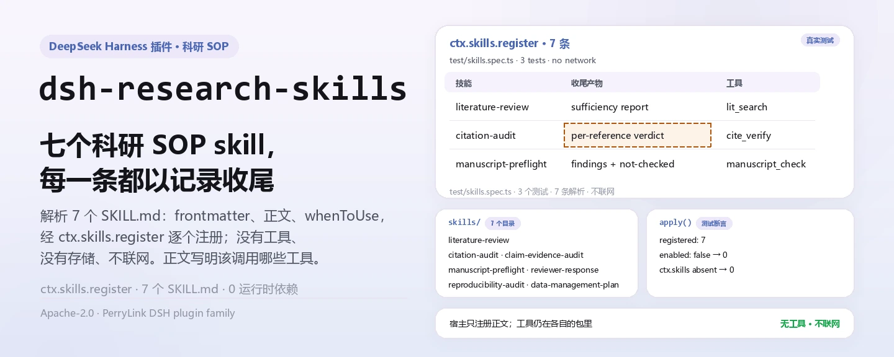
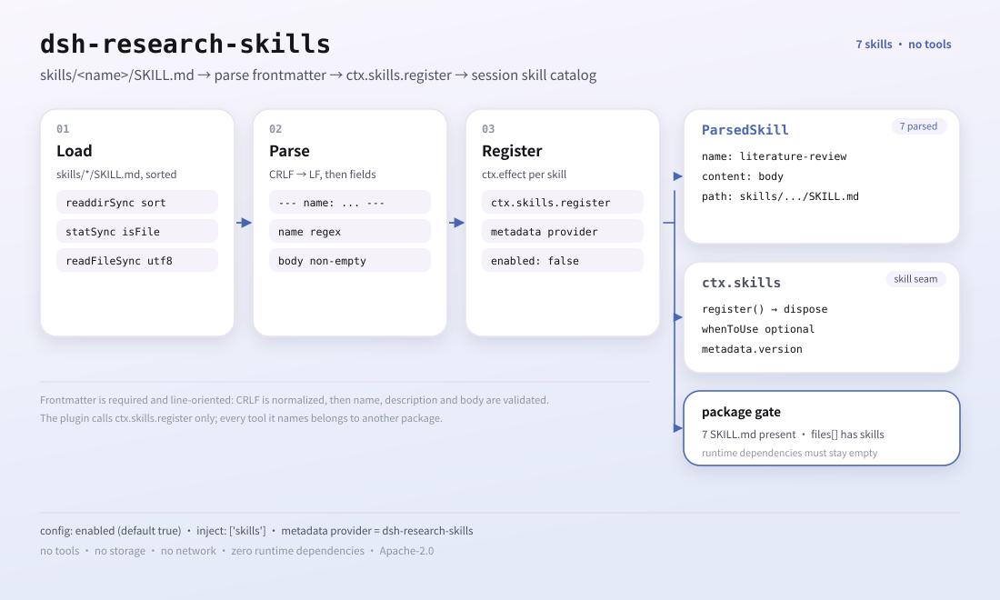
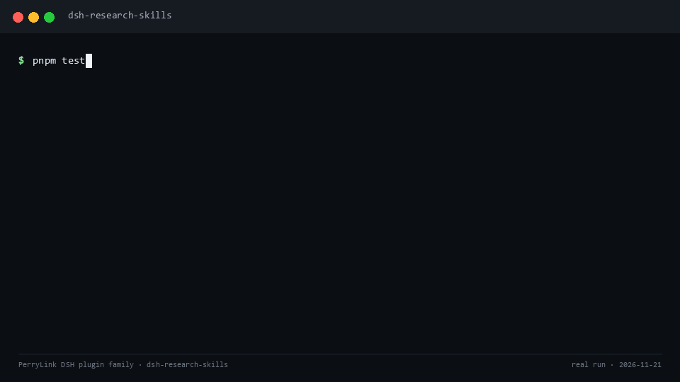

<div align="center">

<picture>
  <source media="(prefers-color-scheme: dark)" srcset="docs/assets/dsh-research-skills-hero-zh-dark.webp">
  
</picture>

# dsh-research-skills

**七个科研 SOP skill —— 每一个都以记录或明确结论收尾，而不是只写一段话。**

*文献综述 · 引文审计 · claim/证据审计 · 投稿前检查 · 审稿回复 · 复现审计 · 数据管理计划。插件只注册 skill 正文，工具仍在各自的包里。*

[English](README.md) · [Español](README-es.md) · [Português](README-pt.md) · [हिन्दी](README-hi.md)

[](LICENSE)

<sub>宿主兼容性：DeepSeek Harness `dsh-v0.2.2-rc.4`（2026-11-18 核验）。</sub>

</div>

---

## 技能

| Skill | 什么时候用 | 收尾产物 |
|---|---|---|
| `literature-review` | 要综述 / related work / 证据地图 | 充分性报告 + 密封报告 |
| `citation-audit` | 参考文献要真实、元数据正确、未被撤稿 | 逐条结论 + 导出 |
| `claim-evidence-audit` | claim 需要对照证据核查 | claim → evidence → verdict 轨迹 |
| `manuscript-preflight` | 准备投稿 | 按检查项分组的问题 + 未检查清单 |
| `reviewer-response` | 需要逐条回复审稿意见 | 覆盖表 + 回复信 |
| `reproducibility-audit` | “别人能复现吗？” | artifact 清单 + 漂移结论 |
| `data-management-plan` | 要交 DMP / 伦理 / 数据可用性声明 | 已完成章节 + 待确认问题 |

每个 `SKILL.md` 都写明具体工具（`lit_search`、`cite_verify`、`claim_check`、`research_trail`、`repro_audit`、`dmp` …）、调用顺序，以及绝不能声称的东西。

<picture>
  <source media="(prefers-color-scheme: dark)" srcset="docs/assets/dsh-research-skills-flow-v5-dark.svg">
  /SKILL.md 被逐个读取，YAML frontmatter 与正文被解析和校验，再经 ctx.skills.register 注册，会话技能目录里就有全部七个；右侧是解析出的字段与注册接缝，底部包检查守住已发布文件清单与零运行时依赖">
</picture>

*结构：加载 → 解析 → 注册；七个 `SKILL.md` 正文就是这个插件的全部，它们引用的工具都在别的包里。图内只有真实 API 与字段名，五语共用同一张结构图。*

## 安装

```sh
dsh plugin --profile <name> add dsh-research-skills
dsh --profile <name> --dump-config | grep dsh-research-skills
```

技能会出现在会话技能目录中；它们引用的工具是独立包（完整套件请安装 research suite）。

## 它不做什么

- **没有工具、没有存储、不联网。** 只调用 `ctx.skills.register`。
- **没有隐藏指令。** 每个正文都是本包里的纯 `SKILL.md`。
- **没有期刊专属规则。** 清单类技能会说明覆盖了哪些指南起步项、没覆盖哪些。

## 兼容性

| | |
|---|---|
| DeepSeek Harness | peer 区间 `dsh-v0.2.2-rc.4`（2026-11-18）；`>=0.2.1-0 <0.3.0 \|\| >=0.2.2-0 <0.3.0` |
| Node | `^22.19.0 \|\| >=24.9.0` |
| 运行时依赖 | **零** |

## 开发



*动图是 2026-11-21 真实运行的 `pnpm test`、`pnpm run verify:package` 与 `pnpm run check:lockfile` 输出（1 个文件 3 个测试；插件没有 CLI，所以它自己的测试套件与包检查就是这次运行）。勾选符号因终端字体没有该字形而省略；文件名、计数与检查行均逐字保留。*

```sh
pnpm install
pnpm run check:lockfile
pnpm typecheck
pnpm test
pnpm build
pnpm verify:package
```

锁文件按 `pnpm install --lockfile-only` 的原样提交（两段：pnpm 自身的管理文档 + 项目文档），本地 `pnpm install` 不会改写它；`pnpm run check:lockfile` 在它与 `package.json` 不一致或丢失该形式时失败。

## 许可

Apache-2.0，见 [LICENSE](LICENSE)。
