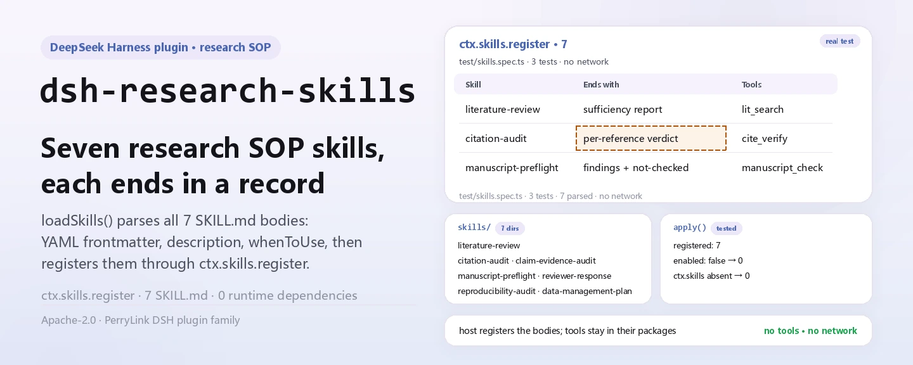
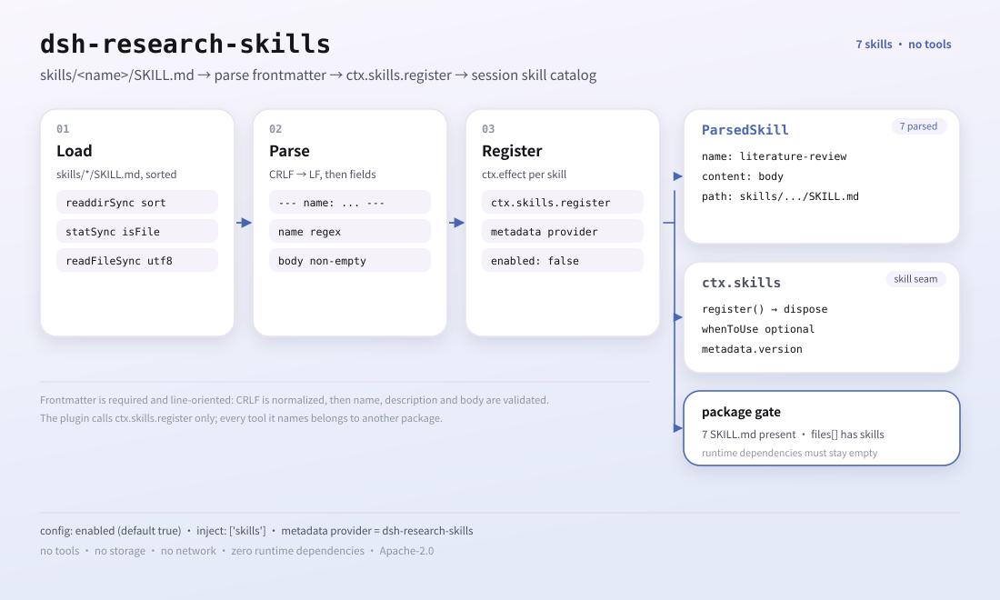

<div align="center">

<picture>
  <source media="(prefers-color-scheme: dark)" srcset="docs/assets/dsh-research-skills-hero-en-dark.webp">
  
</picture>

# dsh-research-skills

**Seven research SOP skills for DeepSeek Harness — each one ends in a record or an explicit verdict, never prose alone.**

*Literature review · citation audit · claim/evidence audit · manuscript preflight · reviewer response · reproducibility audit · data-management plan. The plugin registers the skill bodies; the tools stay in their own packages.*

[简体中文](README-zh.md) · [Español](README-es.md) · [Português](README-pt.md) · [हिन्दी](README-hi.md)

[](LICENSE)

<sub>Host compatibility: DeepSeek Harness `dsh-v0.2.2-rc.4` (verified 2026-11-18).</sub>

</div>

---

## Skills

| Skill | Use it when | Ends with |
|---|---|---|
| `literature-review` | a review / related work / evidence map is requested | sufficiency report + sealed report |
| `citation-audit` | a reference list must be real, correct and not retracted | per-reference verdict + export |
| `claim-evidence-audit` | claims need to be checked against their evidence | claim → evidence → verdict trail |
| `manuscript-preflight` | the user is about to submit | findings by check + "not checked" list |
| `reviewer-response` | reviewer comments need a point-by-point letter | coverage table + response letter |
| `reproducibility-audit` | "can someone reproduce this?" | artifact manifest + drift verdict |
| `data-management-plan` | a DMP / ethics / data-availability statement is due | completed sections + open questions |

Each `SKILL.md` names the concrete tools (`lit_search`, `cite_verify`, `claim_check`, `research_trail`, `repro_audit`, `dmp`, …), the order to call them, and what must never be claimed.

<picture>
  <source media="(prefers-color-scheme: dark)" srcset="docs/assets/dsh-research-skills-flow-v5-dark.svg">
  /SKILL.md is read, its YAML frontmatter and body parsed and validated, then each one is registered through ctx.skills.register so the session skill catalog holds all seven; the parsed fields and the registration seam are shown on the right, and the package gate keeps the published file list and the empty runtime dependency set honest">
</picture>

*Structure: load → parse → register; the seven `SKILL.md` bodies are the whole plugin, and the tools they name live in other packages. The token labels inside the diagram are the real API and field names, so the same picture serves all five languages.*

## Install

```sh
dsh plugin --profile <name> add dsh-research-skills
dsh --profile <name> --dump-config | grep dsh-research-skills
```

The skills appear in the session skill catalog; the tools they reference are separate packages (install the research suite for the full set).

## What it does not do

- **No tools, no storage, no network.** It only calls `ctx.skills.register`.
- **No hidden instructions.** Every body is a plain `SKILL.md` in this package.
- **No journal-specific rules.** The checklist skills say which guideline starter items they cover and which they do not.

## Compatibility

| | |
|---|---|
| DeepSeek Harness | peer line `dsh-v0.2.3-alpha.1`（2026-11-22）；`>=0.2.1-0 <0.3.0 \|\| >=0.2.2-0 <0.3.0` |
| Node | `^22.19.0 \|\| >=24.9.0` |
| Runtime dependencies | **zero** |

## Development


*Animated: the real `pnpm test`, `pnpm run verify:package` and `pnpm run check:lockfile` output on 2026-11-21 (3 tests in 1 file; the plugin has no CLI, so its own suite and package gates are the run). The pass marker is omitted because the terminal font has no check-mark glyph; the file names, counts and gate lines are verbatim.*

```sh
pnpm install
pnpm run check:lockfile
pnpm typecheck
pnpm test
pnpm build
pnpm verify:package
```

The lockfile is committed exactly as `pnpm install --lockfile-only` writes it (two documents: pnpm's own package-manager document, then the project document), so a local install does not rewrite it. `pnpm run check:lockfile` fails when the lockfile drifts from `package.json` or loses that form.

## License

Apache-2.0. See [LICENSE](LICENSE).
